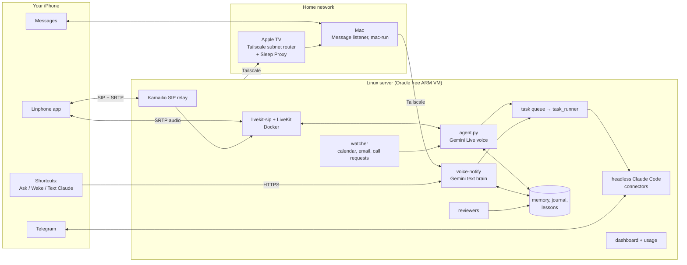

# SuperClaude: a "dots" alternative for Claude, but better

**A self-hosted alternative to OpenAI's dots, built on Claude. It's always on: text it on iMessage, and it phones you when something matters.**

SuperClaude is a "Jarvis"-style assistant built with Claude Code on free infrastructure. It has a fast voice that answers real phone calls, a text brain that replies on iMessage in seconds, and headless Claude Code doing the actual work in the background. It remembers you, reviews its own conversations so it improves, and can control your Mac.

A beginner built it in two days by talking to Claude Code. This repo has the real code from that build with every personal detail removed. It also has a step-by-step guide that explains each part, and a skill your own coding agent can use to install and maintain it.

> **Status:** this is a personal project that is shared so others can learn from it and adapt it. It's not a polished product, and setup takes an afternoon of careful steps. Every setting described here comes from the working build. Anything that wasn't verified is marked as an assumption.

---

## What it can do

**Talk on the phone (both ways)**
- **Calls you by itself**: 10 minutes before calendar events, when an important email arrives, when a long task finishes, or when a question to you goes unanswered.
- **You can call it** from the free Linphone app. It picks up with a greeting in its own voice.
- Fast turn-taking: Gemini Live voice with about 1 s to first audio, HD G.722 audio and noise removal.
- **Never ghosts you**: code guards force a reply if the model goes quiet, recover a "deaf" session, and catch false claims like "I changed it" when no tool actually ran.
- Plays varied "working" sounds while it thinks, and lets you change pace or style by voice.
- Pronunciation fixes: when it can't get a name right, it sends you numbered audio options to pick from.

**Text on iMessage (and Telegram)**
- Text its own Apple ID like a contact named "Claude". Quick answers come back in about 3–4 s from a Gemini text brain. Anything real is handed to Claude.
- Send photos, voice notes (transcribed and treated as your words), videos and files.
- "Important" messages go to iMessage first. If you haven't answered after about 10 minutes, it calls you.
- Telegram is the backup channel and carries alerts, call notes and approvals.

**Do real work**
- Every real task goes to **headless Claude Code** with your connectors (Gmail, Calendar, Drive …), through a queue with timeouts, a kill switch and a live dashboard.
- **Controls your Mac** from anywhere: wakes it from sleep, runs Claude Code there, lists and resumes your Mac Claude sessions, looks at the screen, and sends iMessages.
- **Reads back before sending** anything (email, text, message to a session). The go-ahead is checked in code, not just in the prompt.

**Remember and improve**
- Memory: facts (public and private), a daily journal, promises, goals, people, projects, mistakes and lessons. All of it is fed into every call and chat.
- **Self-review**: after each call and each text conversation, a reviewer grades it against a 9-point checklist and writes new "lessons". Safe ones apply automatically and you can undo them. Anything touching safety, privacy or sending needs your approval.
- Nightly fact extraction, a weekly review, and one "is this still true?" question a day.

**Proactive helpers (all optional)**
- Morning briefing, reminders, mail watch, gym log, clip vault, a build watcher and a "patch radar".
- **Creator tools**: YouTube upload monitor (flags videos doing 2× or 0.5× your median), weekly channel report, Gemini video review and quick edits.
- **Job-search helpers**: digest, application helper, interview debrief calls.

**Safety net**
- Health check every 5 minutes, alerts when a service fails, nightly backup, daily summary.
- An "ask first" list (payments, deleting, posting publicly, messaging other people, security settings) that self-learning can never relax.
- Quiet hours and daily caps on calls and texts.

See [docs/features.md](docs/features.md) for the full list.

---

## How it compares to "dots"

OpenAI's [dots](https://learn.chatgpt.com/docs/dots) is an always-on cloud agent you reach in ChatGPT, Slack or Teams. iMessage/RCS texting is in beta for ChatGPT Pro users in the U.S. The comparison below uses OpenAI's own docs as of November 2026.

| | **dots** (OpenAI, per its docs) | **SuperClaude** |
|---|---|---|
| Who runs it | OpenAI's cloud | You, on a free Oracle VM (or an always-on Mac) |
| Availability | Rolling out gradually to eligible accounts | Anyone can set it up today |
| Phone calls | Call your dot inside the ChatGPT app. Texting doesn't support phone calls. | **Real phone calls both ways**: it rings your phone on its own, and you can call it |
| Texting | iMessage/RCS beta (Pro, U.S.) | iMessage through your own Mac and a separate Apple ID, plus Telegram |
| Your computer | Connect one personal computer | Your Mac, woken from sleep over Tailscale |
| Your data | Stored by OpenAI | On your own server, in plain files you can read |
| Change how it works | Settings and rules | Change anything: it's your code |
| Cost | ChatGPT plan | Free infrastructure (Oracle free tier, Gemini free tier, Linphone, Tailscale) plus your existing Claude Pro/Max plan |

dots is easier: there's nothing to install. SuperClaude is for people who want an assistant that **calls them**, keeps their data on their own machines, and can be taken apart and changed.

---

## How it works (one picture)



- **Voice:** Phone ⇄ Linphone's free SIP service ⇄ Kamailio relay ⇄ livekit-sip ⇄ LiveKit ⇄ `agent.py` (Gemini Live). Gemini is the fast front desk. Anything that needs real work becomes a task for Claude.
- **Text:** iPhone → the agent's Apple ID → the Mac's Messages app → the Mac listener reads `chat.db` → server → Gemini text brain → reply sent back out through the Mac. Real work goes to Claude.
- **Mac link:** the server reaches your Mac over Tailscale through an Apple TV acting as a subnet router. The Apple TV is also the Bonjour Sleep Proxy, so connecting to the Mac wakes it from sleep.

Each flow is explained hop by hop in [docs/how-it-works/](docs/how-it-works/).

---

## Set it up

Follow [docs/setup/](docs/setup/00-overview.md) in order:

| # | Step |
|---|---|
| 00 | [Overview: choose an Oracle server or an always-on Mac](docs/setup/00-overview.md) |
| 01 | [Oracle free VM (or any Linux box)](docs/setup/01-server-oracle.md) |
| 02 | [Docker, LiveKit and livekit-sip](docs/setup/02-docker-livekit-sip.md) |
| 03 | [Linphone accounts and app settings (SRTP, G722 on, PCMA/PCMU off)](docs/setup/03-linphone.md) |
| 04 | [Gemini API key](docs/setup/04-gemini.md) |
| 05 | [Claude Code on the server](docs/setup/05-claude-code.md) |
| 06 | [Tailscale on the server, Mac and Apple TV (wake from sleep)](docs/setup/06-tailscale-apple-tv-mac.md) |
| 07 | [The Mac: Remote Login, keys, Full Disk Access, Accessibility](docs/setup/07-mac.md) |
| 08 | [A separate Apple ID for the agent](docs/setup/08-apple-id-imessage.md) |
| 09 | [iPhone Shortcuts: Call me, Ask / Wake / Text Claude, Force Wake](docs/setup/09-shortcuts.md) |
| 10 | [Telegram bot, nginx and HTTPS](docs/setup/10-telegram-nginx-https.md) |
| 11 | [systemd services and timers](docs/setup/11-systemd-services.md) |
| 12 | [Running it all on an always-on Mac instead](docs/setup/12-always-on-mac-host.md) |

Settings go in one file: copy [config/superclaude.env.example](config/superclaude.env.example) and fill it in. **Never commit the filled-in copy.**

### Let your coding agent do it
The [`superclaude` skill](skills/superclaude/SKILL.md) teaches Claude Code (or Codex) how to install, debug and extend the assistant safely.

```bash
# Claude Code
ln -s "$PWD/skills/superclaude" ~/.claude/skills/superclaude
# Codex (it also finds .agents/skills/ inside this repo by itself)
ln -s "$PWD/skills/superclaude" ~/.agents/skills/superclaude
```

Then ask: *"Use the superclaude skill to set this up on my server."* It will still need you for sign-ins, phone settings and macOS permission prompts.

**Codex?** The skill and docs work in Codex. The running assistant uses Claude Code as its worker. Details are in [docs/codex.md](docs/codex.md).

---

## Repo map

| Path | What |
|---|---|
| `server/voice-caller/` | Voice agent (`agent.py`), outbound call helper, watcher, inbound setup, LiveKit/SIP config, tests |
| `server/lib/voice-tasks/` | Task queue runner (headless Claude), capability list, working sounds |
| `server/lib/voice-notify/` | Text brain, Gemini text proxy, "Ask Claude" endpoint, notifications and questions, media inbox |
| `server/lib/voice-memory/` | Memory, journal, lessons, call and chat reviewers |
| `server/lib/voice-sip-relay/` | Kamailio relay that keeps the server's Linphone account registered for inbound calls |
| `server/lib/voice-dashboard/` | Job dashboard and plan-usage meter |
| `server/lib/voice-safety/` | Health check, alerts, backup, daily summary, `agent-*` commands |
| `server/lib/voice-extras/`, `voice-creator/` | Optional proactive, job-search and creator helpers |
| `server/systemd/`, `server/nginx/` | Service units, timers, drop-ins; nginx site |
| `mac/bin/` | Mac side: iMessage listener and sender, `mac-run` worker, screen look, journal hook, wake lease |
| `config/` | Env templates (placeholders only) |
| `docs/` | Setup, how it works, features, troubleshooting, Codex notes |
| `skills/superclaude/` | The maintenance skill |

## Troubleshooting
Every real bug found while building it, with its root cause and fix: [docs/troubleshooting.md](docs/troubleshooting.md).

## Privacy and security
- No secrets live in this repo. Keys go in root-only env files on your server (see the setup docs).
- Private memory facts (health, money, ID numbers and similar) never go to Gemini. Only Claude sees them.
- The SIP relay accepts calls only from your own Linphone account.
- The web endpoints use secret URL paths behind HTTPS. The Mac and the server talk over dedicated SSH keys, and the key the Mac uses to forward messages to the server is restricted to that one job.

## License
[MIT](LICENSE). Use at your own risk. The assistant can send messages and run code for you, so read the safety sections before you turn those features on.
